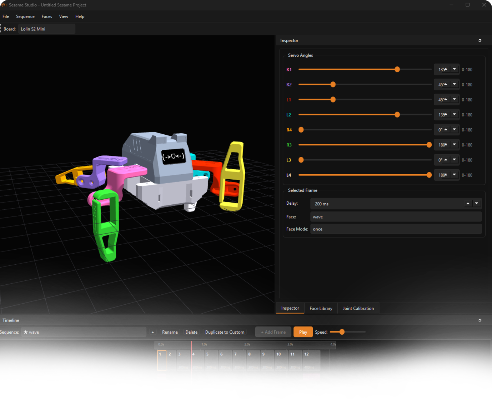

# Sesame Studio

Sesame Studio is the standalone animation, pose sequencing, and OLED face design tool for the [Sesame Robot](https://github.com/dorianborian/sesame-robot). Pose the robot in a real 3D viewport built from the printed STL geometry, sequence poses on an interactive timeline, paint 128×64 OLED faces pixel-by-pixel, and directly open, edit, and save Arduino C firmware headers (`face-bitmaps.h`).



---

## Features

- **3D Posable Viewport**: Renders the robot's real printed limb and frame geometry driven live by servo angles. Features orbit/pan/zoom camera control and on-screen angle readouts. Bundled with 3D model assets so it runs completely self-contained.
- **Joint Calibration**: Joint pivots are auto-estimated from STL geometry; an integrated calibration panel lets you fine-tune pivot positions and rotation axes per joint against your physical hardware.
- **Timeline Editor**: Named sequences of pose frames, drag-to-reorder, edge dragging to retime transitions, right-click frame operations (duplicate/insert/delete), and real-time playback at adjustable speeds.
- **Inspector**: Per-servo sliders and numeric readouts clamped to each joint's mechanical angle limits, plus per-frame delay and face assignment.
- **Direct `face-bitmaps.h` Firmware Editing**: Open any Arduino `face-bitmaps.h` file directly (**File → Open Face Bitmaps (.h)...**). View and edit all faces (including multi-frame animated faces and unallocated `FACE_LIST` symbols), paint frames, add or delete expressions, and save directly back to the header file without manual copy-pasting.
- **Face Editor ("Bitmap Paint")**: A 128×64 1-bit canvas matching the SSD1306 OLED display exactly. Equipped with pencil, eraser, line, rectangle, ellipse, and flood fill tools, plus text placement. Supports multi-frame animation (up to 6 frames) with onion-skinning and live hex byte-array inspection.
- **Face Library**: Searchable, filterable catalog of all expressions with category filtering (Movement, Conversational, Talk, Special, Custom). Assign expressions to timeline frames with one click.
- **Project Files**: Save and load full projects as `.sesproj` (JSON) — keeping sequences, custom faces, and settings intact across sessions.
- **Firmware Code Exporter**: Generates `runXPose()` C motion functions and `FACE_LIST` / byte-array definitions ready for deployment into Sesame firmware.
- **Guided Onboarding**: Interactive first-run tour with coach marks and built-in help guides.

---

## Downloads & Releases (Windows)

For Windows users who want to run Sesame Studio without installing Python:
* **Standalone Portable Executable**: Download `SesameStudio.exe` (or `SesameStudio-v2.0.0-windows-x64.zip`) from the [Releases](https://github.com/dorianborian/sesame-studio/releases) page.
* No installation, Python setup, or extra dependencies required. Simply double-click `SesameStudio.exe` to run.

---

## Installation (Running from Source)

### Prerequisites
- **Python 3.10+**
- Windows, macOS, or Linux

### Setup
1. Clone this repository:
   ```bash
   git clone https://github.com/dorianborian/sesame-studio.git
   cd sesame-studio
   ```

2. Create and activate a virtual environment (optional but recommended):
   ```bash
   python -m venv .venv
   # Windows:
   .venv\Scripts\activate
   # macOS/Linux:
   source .venv/bin/activate
   ```

3. Install dependencies:
   ```bash
   pip install -r requirements.txt
   ```
   *(PySide6, PyOpenGL, numpy, Pillow)*

### Building the Portable Windows Executable
To package your own standalone `.exe` from source:
```bash
pip install pyinstaller
python build_windows_exe.py
```
This generates `dist/SesameStudio.exe` and `dist/SesameStudio-v2.0.0-windows-x64.zip`.

---

## Usage

### Launching the Studio
```bash
python sesame_studio.py
```

### Motion Design Workflow
1. Click **New Project** on the welcome screen (or open an existing `.sesproj`).
2. Adjust servo angles in the **Inspector**; the 3D viewport updates in real time.
3. Click **+ Add Frame** in the **Timeline** to capture keyframe poses.
4. Drag frames to adjust ordering or retime transition delays. Hit **Play** to preview.
5. Save your project (`.sesproj`) or choose **File → Export** to generate Arduino code.

### Face Design & Firmware Editing
- **Direct Firmware Editing**: Go to **File → Open Face Bitmaps (.h)...** and select your robot's `firmware/face-bitmaps.h`. The Face Library will switch to header editing mode. Double-click any face to paint, add new faces with C-identifier validation, and click **Save .h** to persist changes directly to the firmware.
- **Standalone Face Design**: Create custom faces in your project library, draw frame-by-frame animations, preview at custom frame rates, and export individual byte arrays anytime.

---

## Project Structure

```
sesame-studio/
├── app/
│   ├── main_window.py       # Main application window, docking, menu routing
│   ├── project.py           # .sesproj data model and JSON serialization
│   ├── paths.py             # Centralized asset, resource & user-data path resolution
│   ├── servo_model.py       # Servo definitions, angle constraints, categories
│   ├── viewport3d.py         # OpenGL 3D posable robot viewport & STL loader
│   ├── timeline.py          # Keyframe sequence and playback timeline
│   ├── inspector.py         # Servo slider controls and frame metadata
│   ├── face_editor.py       # 128x64 1-bit pixel editor with animation tools
│   ├── face_library.py      # Face management grid, search, and header mode banner
│   ├── face_bitmaps.py      # Direct Arduino face-bitmaps.h parser and serializer
│   ├── builtin_faces.py     # Builtin face loader from firmware assets
│   ├── code_export.py       # C++ sequence & bitmap code generators
│   ├── tutorial.py          # Guided tour & documentation dialogs
│   ├── splash.py            # Launch splash screen
│   └── welcome.py           # Project start/open welcome page
├── assets/
│   ├── joints_config.json   # Kinematic joint pivot and axis calibration
│   ├── sesame-icon.ico      # Multi-resolution Windows executable icon
│   ├── stl/                 # 3D printable mesh assets for viewport rendering
│   └── firmware/            # Reference face-bitmaps.h and firmware templates
├── tests/
│   ├── test_face_bitmaps.py      # Unit tests for C header parser & serializer
│   └── test_face_bitmaps_gui.py  # Qt GUI integration tests
├── build_windows_exe.py     # Release packaging script
├── SesameStudio.spec        # PyInstaller specification
├── requirements.txt         # Python package dependencies
├── sesame_studio.py         # Application entry point
└── README.md
```

---

## Related Projects

- **[Sesame Robot](https://github.com/dorianborian/sesame-robot)**: The main hardware repository containing 3D printing STL files, PCB designs, wiring schematics, assembly guides, and Arduino ESP32 firmware.

---

## License

This project is licensed under the Apache License 2.0. See [LICENSE](LICENSE) for details.
