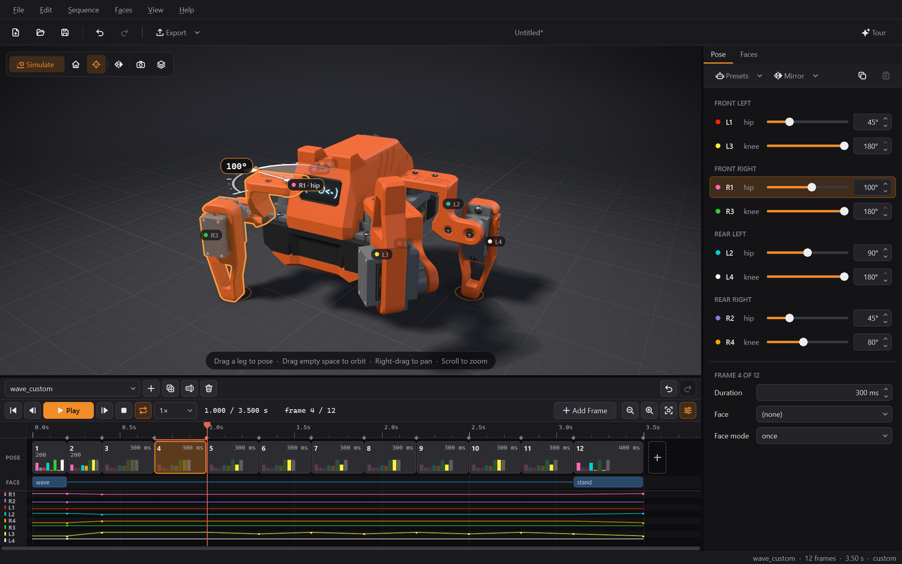

# Sesame Studio

Sesame Studio is the standalone animation, pose sequencing, and OLED face design tool for the [Sesame Robot](https://github.com/dorianborian/sesame-robot). Pose the robot by dragging its legs in a CAD-exact 3D view, watch it stand, walk and tip over in a built-in physics preview, sequence poses on a fast keyframe timeline, paint 128×64 OLED faces pixel-by-pixel, and open, edit, and save Arduino C firmware headers (`face-bitmaps.h`) directly.



---

## Features

- **CAD-exact 3D robot**: The full assembly — printed shell and legs, all eight SG90 servos, horns, screws, OLED, battery, distro board and power switch — converted from the robot's STEP file, with joint pivots taken from the real servo shaft axes. Rendered with physically based materials, soft shadows and a live glowing OLED. Switch between top-cover variants (CAD, Enclosed, Cat, No-Ears), tint the shell, or ghost it to see the internals.
- **Direct manipulation**: Hover a leg to highlight it, click to select, drag to rotate its joint (Ctrl snaps to 5°, Shift for fine control, Shift+drag a foot for two-joint IK). A ring gizmo shows the 0–180° range and current angle. Mirror posing drives the left/right twin automatically.
- **Physics preview**: A lightweight rigid-body simulation with ground contact, friction and a servo-speed model. Play any sequence and the robot actually does it on the floor — stands up, does push-ups, walks and turns — instead of waving its legs in mid-air. Toggle with **Simulate**.
- **Timeline**: Custom-painted keyframe timeline with per-frame servo bars, a face lane and eight servo curve tracks. Zoom and fit, drag to reorder with a drop marker, drag an edge to retime (10 ms snap), multi-select, cut/copy/paste, loop and speed controls, and full undo/redo for every edit.
- **Pose panel**: Per-servo sliders grouped by leg, linked to the 3D selection, with presets (Stand / Rest), left↔right mirroring and pose copy/paste.
- **Built-in firmware sequences**: Every motion the firmware ships (walk, dance, wave, push-up, …) is available read-only to play and study; duplicate one to edit your own copy.
- **Face Painter**: A 128×64 1-bit canvas matching the SSD1306 OLED. Pencil, eraser, line, rectangle, ellipse, flood fill, text and marquee select/move; symmetry drawing; brush sizes; per-frame undo; up to 6 animation frames with onion skinning and an animated preview; image import with threshold and dithering. The robot's screen mirrors the canvas live while you paint.
- **Face Library**: Thumbnail grid of all expressions with search and category chips; animated faces play on hover. Assign a face to the selected timeline frame with one click.
- **Direct `face-bitmaps.h` editing**: Open an Arduino `face-bitmaps.h` (**File → Open Face Bitmaps (.h)…**), edit any face, add or delete expressions, and save straight back to the header.
- **Project files**: Save and load full projects as `.sesproj` (JSON) — sequences, custom faces and settings.
- **Firmware code exporter**: Generates `runXPose()` C motion functions and `FACE_LIST` / byte-array definitions ready to paste into Sesame firmware.
- **Interactive tour**: A hands-on walkthrough on first run (and any time from **Help → Interactive Tour**), plus a searchable help center with a keyboard shortcut reference.

---

## Downloads & Releases (Windows)

For Windows users who want to run Sesame Studio without installing Python:
* **Standalone Portable Executable**: Download `SesameStudio.exe` (or `SesameStudio-v3.0.0-windows-x64.zip`) from the [Releases](https://github.com/dorianborian/sesame-studio/releases) page.
* No installation, Python setup, or extra dependencies required. Simply double-click `SesameStudio.exe` to run.

---

## Installation (Running from Source)

### Prerequisites
- **Python 3.10+**
- Windows, macOS, or Linux

### Setup
1. Clone this repository:
   ```bash
   git clone https://github.com/dorianborian/sesame-studio.git
   cd sesame-studio
   ```

2. Create and activate a virtual environment (optional but recommended):
   ```bash
   python -m venv .venv
   # Windows:
   .venv\Scripts\activate
   # macOS/Linux:
   source .venv/bin/activate
   ```

3. Install dependencies:
   ```bash
   pip install -r requirements.txt
   ```
   *(PySide6, PyOpenGL, numpy, Pillow)* — requires a GPU/driver with OpenGL 3.3.

### Building the Portable Windows Executable
To package your own standalone `.exe` from source:
```bash
pip install pyinstaller
python build_windows_exe.py
```
This generates `dist/SesameStudio.exe` and `dist/SesameStudio-v3.0.0-windows-x64.zip`.

---

## Usage

### Launching the Studio
```bash
python sesame_studio.py
```

### Motion Design Workflow
1. Click **New Project** on the welcome screen (or open an existing `.sesproj`). The first run starts a short interactive tour.
2. Pose the robot: drag a leg in the 3D view, or use the sliders in the **Pose** panel. Drag empty space to orbit, right-drag to pan, scroll to zoom.
3. Click **Add Frame** in the timeline, then pose again — each frame is a pose plus how long the robot takes to get there.
4. Press **Space** to play. With **Simulate** on, the preview shows what the real robot would do on the floor.
5. Drag frames to reorder, drag a frame's right edge to retime, and use **Ctrl+Z** freely.
6. Save your project (`.sesproj`) or choose **Export** to generate Arduino code.

### Face Design & Firmware Editing
- **Direct Firmware Editing**: Go to **File → Open Face Bitmaps (.h)...** and select your robot's `firmware/face-bitmaps.h`. The Face Library will switch to header editing mode. Double-click any face to paint, add new faces with C-identifier validation, and click **Save .h** to persist changes directly to the firmware.
- **Standalone Face Design**: Create custom faces in your project library, draw frame-by-frame animations, preview at custom frame rates, and export individual byte arrays anytime.

---

## Project Structure

```
sesame-studio/
├── app/
│   ├── main_window.py       # Application shell: menus, docks, and the wiring between panels
│   ├── project.py           # .sesproj data model, JSON serialization, bitmap packing helpers
│   ├── paths.py             # Asset, resource & user-data path resolution
│   ├── servo_model.py       # Servo definitions, angle limits, board variants, face categories
│   ├── kinematics.py        # Shared forward kinematics (joint definitions → link transforms)
│   ├── robot_model.py       # Loader for the CAD-derived model in assets/model
│   ├── physics.py           # Rigid-body ground-contact sim + servo speed model
│   ├── viewport3d.py        # 3D viewport widget: camera, picking, drag-to-pose, sim stepping
│   ├── gl_renderer.py       # OpenGL 3.3 renderer (shadows, PBR-style shading, outlines)
│   ├── gl_shaders.py / gl_math.py / gl_labels.py / gl_hud.py
│   ├── timeline.py          # Timeline widget: sequences, transport, undo stack, clipboard
│   ├── timeline_canvas.py / timeline_commands.py / timeline_model.py
│   ├── inspector.py         # Pose panel: servo sliders, mirror/presets, frame fields
│   ├── face_editor.py       # Face painter dialog
│   ├── face_canvas.py / face_core.py / face_render.py / face_widgets.py / face_import.py
│   ├── face_library.py      # Face thumbnail library and header-mode controls
│   ├── face_bitmaps.py      # Arduino face-bitmaps.h parser and serializer
│   ├── builtin_faces.py     # Built-in face loader from firmware assets
│   ├── builtin_sequences.py # The firmware's motions as read-only sequences
│   ├── code_export.py       # C++ sequence & bitmap code generators
│   ├── tutorial.py          # Interactive tour and help center
│   ├── theme.py / icons.py  # Design tokens + stylesheet, vector icon set
│   ├── widgets/             # Shared UI building blocks (toasts, segmented control, cards…)
│   ├── splash.py            # Launch splash screen
│   └── welcome.py           # Start page
├── assets/
│   ├── model/               # Runtime robot model (manifest.json + meshes.npz), generated
│   ├── stl/                 # Printable source meshes (top-cover variants feed the model build)
│   ├── firmware/            # Reference face-bitmaps.h and firmware
│   └── sesame-icon.ico      # Windows executable icon
├── tools/
│   └── build_model.py       # STEP assembly → assets/model converter (needs cadquery-ocp, scipy)
├── tests/                   # pytest suite (model, physics, timeline, faces, viewport, tutorial)
├── build_windows_exe.py     # Release packaging script
├── SesameStudio.spec        # PyInstaller specification
├── requirements.txt         # Python package dependencies
├── sesame_studio.py         # Application entry point
└── README.md
```

### Regenerating the 3D model
The runtime model in `assets/model/` is generated from the robot's CAD assembly. To rebuild it after a hardware change:
```bash
pip install cadquery-ocp scipy
python -X utf8 tools/build_model.py path/to/Sesame-ESP32.step
```

### Running the tests
```bash
pip install pytest
python -m pytest tests -q
```
The 3D viewport tests need a real OpenGL context, which Qt's offscreen platform (used when the whole suite runs in one process) does not provide — they skip there. Run them on their own to exercise rendering, picking and drag-to-pose:
```bash
python -m pytest tests/test_viewport.py -q
```

---

## Related Projects

- **[Sesame Robot](https://github.com/dorianborian/sesame-robot)**: The main hardware repository containing 3D printing STL files, PCB designs, wiring schematics, assembly guides, and Arduino ESP32 firmware.

---

## License

This project is licensed under the Apache License 2.0. See [LICENSE](LICENSE) for details.
